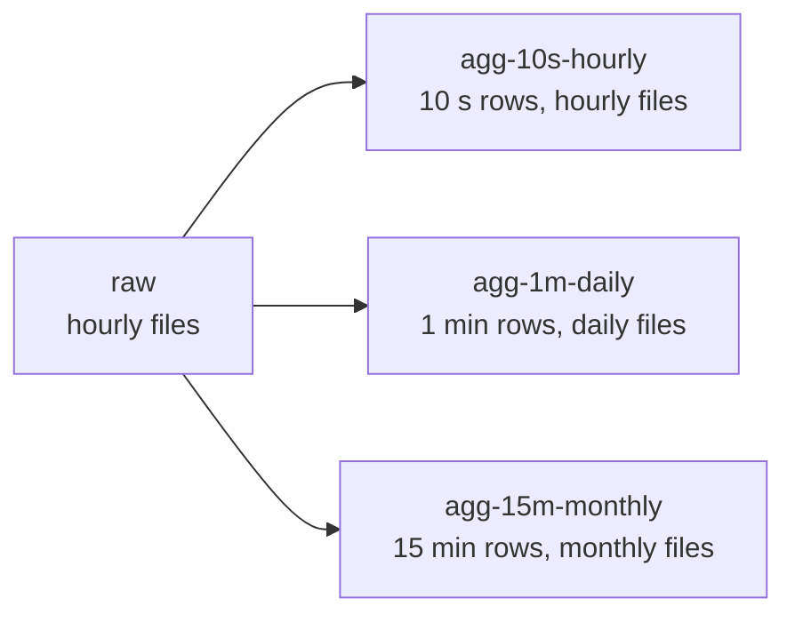
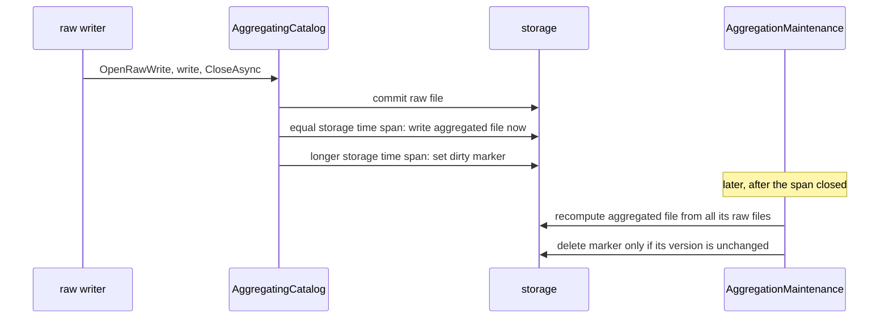

# Aggregation

`Easy.TimeSeries.Aggregation` turns raw readings into coarser views: one row per minute, per hour, per day, and per
group. An aggregated file is an ordinary `.ets` file, readable by the same `Reader`, source-generated readers and the
Parquet converter.

## Two time spans - read this first

Every aggregation is defined by two independent time spans. Mixing them up is the most likely source of mistakes.

| Term | Answers the question | Example | Constraint |
| --- | --- | --- | --- |
| **Aggregation time span** | How much raw time is collapsed into one aggregated row? | 1 minute | Must fit into the storage time span |
| **Storage time span** | How much time does one file cover? | 1 day | Same as the raw storage time span or longer |

An aggregation with a 1-minute aggregation time span and a 1-day storage time span writes one file per day, each
holding up to 1440 rows per group.



## Quick start

```csharp
using Easy.TimeSeries.Aggregation;
using Easy.TimeSeries.Paths;
using Easy.TimeSeries.Storage;

var spec = new AggregationSpec(
        aggregationTimeSpan: AggregationTimeSpan.Minute,
        storageTimeSpan: TimeGranularity.Day)
    .GroupBy("Sensor")
    .Column("Voltage", Agg.Avg, Agg.Min, Agg.Max, Agg.Q95, Agg.Quantile(0.999))
    .Column("Current", Agg.Avg, Agg.StdDev.WithOutput(OutputEncoding.ScaledNumber32(3)))
    .Column("Status", Agg.Last);

var catalog = new FileCatalog(new DirectoryInfo("/data"));
var raw = new PathBuilder("raw", TimeGranularity.Hour);
var downsampler = new Downsampler(spec, rawStorageTimeSpan: TimeGranularity.Hour);

// reads raw/2026/10/25/{00..23}/sensor-a.ets, writes agg-1m-daily/2026/10/25/sensor-a.ets
var result = await downsampler.RunAsync(catalog, raw, "sensor-a", new DateTime(2026, 10, 25, 0, 0, 0, DateTimeKind.Utc));
```

The aggregated file of this spec, for two sensors:

| Timestamp | Sensor | Count | Voltage.Avg | Voltage.Min | ... | Status.Last |
| --- | --- | --- | --- | --- | --- | --- |
| 14:05 | sensor-a | 600 | 230.4 | 228.9 | ... | ok |
| 14:05 | sensor-b | 598 | 229.8 | 227.1 | ... | ok |
| 14:06 | sensor-a | 601 | 231.0 | 229.3 | ... | warn |

## The spec

`AggregationSpec` is immutable: every method returns a new spec, so a base spec can be shared and derived.

| Method | Purpose |
| --- | --- |
| `new AggregationSpec(aggregationTimeSpan, storageTimeSpan)` | Both time spans, required |
| `.Column(label, functions...)` | Predefined functions over one raw column |
| `.Function(function)` | A custom function, usually over several raw columns |
| `.GroupBy(label)` | One series per value of a raw Category column |
| `.Time(label)` | Names the raw time column; needed only when a raw file has several DateTime columns |
| `.CountLabel(label)` | Renames the `Count` column |
| `.WithRoot(root)` | Replaces the default root `agg-{slug}-{word}` |
| `.WithTimeSpans(aggregation, storage)` | Same columns, other time spans |
| `.Describe(rawHeaders)` | The output columns, without decoding data; useful for testing a reader DTO |

Aggregation time spans:

| Value | Slug |
| --- | --- |
| `Second` | `1s` |
| `TenSeconds` | `10s` |
| `Minute` | `1m` |
| `FiveMinutes` | `5m` |
| `FifteenMinutes` | `15m` |
| `Hour` | `1h` |
| `Day` | `1d` |

Rules:

- Slices are aligned to midnight UTC and half-open. A row at 14:05:59.999 belongs to 14:05, one at 14:06:00 to 14:06.
- An aggregated row is stamped with the start of its slice.
- A slice without raw rows produces no row; the time column has a gap. The `Count` column shows sparse slices.
- Output columns are, in order:
  1. time
  2. group, if any
  3. count
  4. one column per function, in the order of `Column` and `Function` calls
- Only raw columns named in the spec are decoded. Raw columns added later are ignored, so the layout depends on the
  spec alone.
- Rows are sorted by time, then group by ordinal string comparison. Recomputing a file never reorders it.

## Predefined functions

| Function | Applies to | Label | Result type |
| --- | --- | --- | --- |
| `Agg.Avg` | numeric | `{column}.Avg` | `double`; `decimal` for Decimal |
| `Agg.Median` | numeric | `{column}.Median` | `double`; `decimal` for Decimal |
| `Agg.Q95`, `Agg.Q99` | numeric | `{column}.Q95`, `{column}.Q99` | `double`; `decimal` for Decimal |
| `Agg.Quantile(p)` | numeric | `{column}.Q{p x 100}`, e.g. `Q99.9` | `double`; `decimal` for Decimal |
| `Agg.Min`, `Agg.Max` | numeric, DateTime, TimeSpan | `{column}.Min`, `{column}.Max` | same as the input |
| `Agg.StdDev` | numeric | `{column}.StdDev` | `double` |
| `Agg.TrueRatio` | Bool | `{column}.TrueRatio` | `double` |
| `Agg.Last` | any | `{column}.Last` | same as the input |

- Numeric means Int32, Int64, Float, Double, ScaledNumber32/64, Decimal and the raw variants.
- A column named without functions defaults to Avg (numeric), TrueRatio (Bool) or Last (Category).
- `.As("label")` sets an explicit label; `.WithOutput(encoding)` an explicit output encoding.
- Every aggregated label must be unique. `Agg.Q95` and `Agg.Quantile(0.95)` on one column collide; `Agg.Median` and
  `Agg.Quantile(0.5)` do not (`Median` and `Q50`).

Definitions:

- **Quantiles** interpolate linearly between the two closest ranks (Hyndman-Fan type 7, as NumPy and Excel
  `PERCENTILE.INC`). Q50 equals the median.
- **StdDev** is the population standard deviation (divides by n); a single row yields 0.
- **Avg** sums integers exactly in `Int128` and doubles with compensated summation. Decimal stays exact.
- **Last** is the row with the latest timestamp; among equal timestamps the row written last in the raw file.

### Non-finite values

- Numeric functions skip NaN. Median and quantiles rank only real values.
- Last copies the value as is, NaN included.
- When every value of a slice is NaN, the result is NaN. `Count` still counts all raw rows.
- Infinity is a value: it sorts to the ends and propagates into Avg and StdDev.

### Result encodings

| Raw column | Min, Max, Last | Avg, Median, quantiles, StdDev |
| --- | --- | --- |
| ScaledNumber32/64 with N decimals | same | same scaled type with N decimals |
| Decimal | Decimal | Decimal; StdDev is Double |
| DateTimeOrdered | DateTimeUnordered, same precision | - |
| Any other | same | Double |

- Min, Max and Last of a DateTimeOrdered column are stored unordered, because with grouping they can decrease.
- When raw files of one aggregated file differ, the finest encoding wins: the most decimal places, or the lossless type
  (Float, Double, Int32, Int64) when the column types differ.
- The aggregated time column is DateTimeOrdered with `Seconds` precision, or `Days` for the `Day` aggregation time span.

### Range of scaled results

The core scaled writers saturate silently. The downsampler therefore checks every result written to a scaled
encoding: NaN, infinity and values whose scaled integer does not fit fail the aggregated file. The error names the
function; set a wider encoding with `.WithOutput(...)`, e.g. StdDev of a 1-decimal voltage stored with 3 decimals so
small spreads do not round to zero.

## Custom functions

A custom function implements `IAggregationFunction<TOut>` and is added with `.Function(...)`. It can read several raw
columns of the same slice, including the time column.

```csharp
public sealed class AveragePower(string voltage, string current) : IAggregationFunction<double>
{
    public string Name => "Power.Avg";

    public IReadOnlyList<AggregationInput> Inputs { get; } =
    [
        AggregationInput.Of<float>(voltage),   // ScaledNumber32 decodes as float
        AggregationInput.Of<double>(current),
    ];

    public OutputEncoding Output => OutputEncoding.ScaledNumber64(decimalPlaces: 1);

    public double Compute(in AggregationSlice slice)
    {
        var u = slice.Values<float>(0);
        var i = slice.Values<double>(1);
        var sum = 0d;
        for (var k = 0; k < u.Length; k++)
        {
            sum += u[k] * i[k];
        }

        return sum / u.Length;
    }
}
```

- `Inputs` order defines the index used with `slice.Values<T>(index)`. Values are aligned row by row, in time order,
  and never empty.
- `T` is the decoded CLR type: `float`, `double`, `decimal`, `int`, `long`, `DateTime`, `TimeSpan`, `bool` or
  `string`.
- A function with several inputs must declare a concrete `Output`. One with a single input may use
  `OutputEncoding.SameAsInput` or `OutputEncoding.FromInputPrecision`.
- `Compute` is called once per slice and must be thread-safe.

`AggregationSlice` members:

| Member | Meaning |
| --- | --- |
| `Values<T>(input)` | One input's values within the slice |
| `Sorted<T>(input)` | Sorted copy without NaN, shared by all functions on the same raw column within the slice |
| `Times` | Timestamps of the rows, non-decreasing |
| `Start`, `End` | Bounds of the slice's aggregation time span |
| `Group` | Group value, or `null` |
| `Project(input)` | A view with only that input, at index 0, for calling a predefined function |

Predefined functions are public classes in `Easy.TimeSeries.Aggregation.Functions` and can be reused inside a custom
one:

```csharp
private readonly Quantile<double> q90 = new("Current", 0.9);

public double Compute(in AggregationSlice slice)
    => slice.Values<float>(0)[^1] * q90.Compute(slice.Project(1));
```

## The downsampler

`Downsampler` computes one aggregated file per call, from all raw files of its storage time span.

| Overload | Input | Output |
| --- | --- | --- |
| `RunAsync(catalog, rawPaths, subjectId, spanStart)` | The subject's raw files found in a catalog | `{spec root}/{date folders}/{subjectId}.ets` in the same catalog |
| `RunAsync(spanStart, rawFiles, target)` | Any `IReadStorage` per raw bucket | Any `IWriteStorage` |
| `RunAsync(spanStart, rawBuffer, target)` | One raw file in memory | Any `IWriteStorage` |

- Every row of a raw file must lie within the raw storage time span its bucket start names. A row outside fails the
  aggregated file with an error naming the raw file.
- When nothing is aggregated, the target is never written to and no file appears.
- Raw files may differ in schema: columns added, reordered, or stored with another type that decodes alike (e.g.
  Double and DoubleRaw). Inputs are matched by label in each file.
- `AggregationResult` reports the rows and groups written and the raw files and rows read.

Raw data is processed in chunks, in time order. A chunk is one raw file, or the raw files of one slice when the
aggregation time span is longer than the raw storage time span (`Day` over hourly files). Peak memory is about one
chunk of the needed columns, however long the storage time span.

## Target paths

The root names both time spans; the date folders below it follow the storage time span.

```text
agg-1m-daily / 2026/10/25 / sensor-a.ets
   │    │         │
   │    │         └─ date folders: storage time span (1 day -> yyyy/MM/dd)
   │    └─ storage time span: daily
   └─ aggregation time span: 1 minute
```

Storage time spans are spelled out (`hourly`, `daily`, `monthly`, `yearly`) so that "month" never collides with the
"m" of minutes. `spec.CreatePathBuilder()` returns the `PathBuilder` of the aggregated files, for range queries.

## Write-time aggregation

Aggregations can be kept up to date as raw files are written. Two pieces work together:

- `AggregatingCatalog` decorates the storage catalog the raw writers use. It needs no change to the writers: it works
  with the plain `Writer` and every generated writer.
- `AggregationMaintenance` processes the work the hook defers, from a scheduled job or a hosted service owned by the
  application. The library starts no threads.

```csharp
var configuration = new AggregationConfiguration
{
    Raw = new PathBuilder("raw", TimeGranularity.Hour),
    Specs = [tenSecondsHourly, oneMinuteDaily, fifteenMinutesMonthly],
    RawRetention = TimeSpan.FromDays(40),
    OnFailure = failure => logger.LogWarning(failure.Exception, "Aggregation failed: {Failure}", failure),
};

var blobs = new AzureBlobCatalog(containerClient);
var catalog = new AggregatingCatalog(blobs, configuration);

// application write path - unchanged except where the storage comes from
await using var storage = catalog.OpenRawWrite(bucketStart, "sensor-a");
await sensorWriter.WriteAsync(rows, storage);

// scheduled job or a BackgroundService loop
var maintenance = new AggregationMaintenance(blobs, configuration);
await maintenance.ProcessDirtyAsync();
await maintenance.RecoverAsync(now.AddDays(-7), now);
```



### The hook

| Aggregated vs raw storage time span | What happens when a raw file is written |
| --- | --- |
| Equal, e.g. hourly over hourly raw | The aggregated file is computed from the bytes just written, with no second read |
| Longer, e.g. daily over hourly raw | A dirty marker is set for the aggregated file covering the raw file |

- `CloseAsync` of a raw file never fails because of aggregation. When it returns, the raw file is committed; callers
  never need to retry a raw write that succeeded.
- A failed immediate aggregation sets a marker instead, so the processor retries it from storage.
- If two writers commit the same raw path at once, the hook detects it and sets a marker rather than keeping a result
  computed from the losing writer's bytes.
- Problems go to `OnFailure`. The callback is for monitoring only; exceptions it throws are ignored.
- Every other catalog operation passes through unchanged. Deleting a raw file, e.g. for retention, marks nothing.

### Dirty markers

A marker records that one aggregated file must be (re)computed:

```text
dirty / agg-1m-daily / 2026/10/25 / sensor-a.json
  │         │             │
  │         │             └─ date folders and subject of the aggregated file
  │         └─ aggregated root
  └─ marker root (MarkerRoot, default "dirty")
```

Failed markers live under `{marker root}/failed/`, so a spec root must not start with a `failed` folder.

`ProcessDirtyAsync` handles each marker:

1. It is skipped while its span is open: until the span end plus `GracePeriod` (default 5 minutes).
2. The aggregated file is computed from all raw files of the span in storage.
3. The marker is deleted only if its version is unchanged.

A raw write during step 2 rewrites the marker, the delete in step 3 fails, and the next run includes the late data.
A late raw file therefore can never be lost from its aggregated file. Many raw writes into one span collapse into one
marker, so a backfill costs one recompute per aggregated file.

`MaxDegreeOfParallelism` bounds how many aggregated files one call computes at once.

Subject ids are file names, so listing the raw files of a span returns every subject's files. One call lists each span
once and shares the listing among all markers of that span, so closing a day for many subjects costs one listing, not
one per subject.

### Failing markers

Some failures repeat on every attempt: a raw row outside its time span, a schema that no longer matches the spec, a
result out of range.

- A failed attempt rewrites the marker with an attempt count and the error.
- The next attempt waits `RetryDelay` (default 10 minutes), doubled after each further failure, and the marker is
  counted as `Deferred` until then. A short storage outage therefore does not use up all attempts: with the defaults a
  marker reaches the failed folder 30 minutes after its first failure at the earliest.
- After `MaxAttempts` (default 3), the marker moves to `dirty/failed/...` and is reported as `MovedToFailed`.
- A later raw write into the span sets a fresh marker with no delay, so replacing the bad raw file retries
  automatically.
- `ListFailedAsync` and `RearmAsync` inspect and re-arm failed markers, e.g. after fixing a spec.
- `MarkDirtyAsync` requests a recompute of one aggregated file explicitly.

### Raw retention

Raw files are usually kept shorter than their aggregations. Recomputing a span whose oldest raw files are already gone
would overwrite a complete aggregated file with a partial one.

- A span that starts earlier than now minus `RawRetention` is never recomputed. Its markers are removed and reported
  as `RejectedByRetention`.
- `RawRetention` must be at least the longest storage time span plus the grace period, so every span can still be
  computed when it closes. A monthly aggregation needs at least 31 days plus the grace period.
- Missing raw files are never a reason to recompute; an aggregated file without raw files is the expected state after
  retention.

### Recovery

`RecoverAsync(from, to)` is the safety net for raw files written without the hook, and for markers lost because
marking failed after a raw commit.

- It lists the raw files in the range, clipped to the raw retention, and sets a marker for every aggregated file whose
  source record is missing, does not list one of those raw files in its current version, or was written for another
  version of the aggregated file.
- It recomputes nothing itself; the next `ProcessDirtyAsync` does.
- It leaves a failed marker alone until one of the span's raw files is newer than the failure, so a span that keeps
  failing is not retried on every recovery run.
- On a `FileCatalog`, it also removes temp files older than `OrphanedTempFileAge` (default 1 hour), left by crashed
  writes.

Each time an aggregated file is written by the hook or the marker processor, a source record is written after it, in
the same folder: `sensor-a.sources.json` next to `sensor-a.ets`. It lists the path and version of every raw file read,
and the version the aggregated write committed. The raw versions tell whether the inputs changed; the aggregated version
tells whether the file in storage is still the one the record describes, and not one an overlapping run wrote over it.
Comparing versions needs no clock, so a file computed seconds after its raw files is not mistaken for stale, and a raw
file replaced within the same second is still noticed.

```text
agg-1m-hourly/2026/10/25/14/sensor-a.ets              aggregated file
agg-1m-hourly/2026/10/25/14/sensor-a.sources.json     raw files it was computed from
dirty/agg-1m-hourly/2026/10/25/14/sensor-a.json       pending recompute, while one is due
```

- A record lives and is deleted together with its aggregated file. `PathBuilder.TryParse` never matches it, because
  subject ids contain no dot, but a plain listing of an aggregated folder shows it.

- A raw file changed after it was listed for a recompute does not match its record, so recovery marks the file again.
- Deleted raw files never make an aggregated file stale; that is the expected state after retention.
- An aggregated file written without a record, e.g. by `ets downsample`, is recomputed once if recovery covers it.

A scheduled job typically recovers a sliding window, e.g. the last 7 days; a full scan is an explicit wide range.

### Deployment

| Backend | Processors per root |
| --- | --- |
| `AzureBlobCatalog` | Any number: conditional deletes are ETag preconditions checked by the service |
| `FileCatalog` | One: compare-and-delete is not atomic across processes |

`FileCatalog` versions are the last-write time and size of a file. A marker rewritten within the file system's
timestamp resolution with the same size would keep its version; with one processor and real-world write rates this
does not happen.

## Command line

`ets downsample` runs the batch downsampler over a directory, with predefined functions only:

```shell
ets downsample --input ./data/raw --output ./data --raw-granularity hour \
    --aggregation 1m --storage day --from 2026-10-01 --to 2026-11-01 \
    --group Sensor --columns Voltage=avg+min+max+q95,Current=avg+stddev,Status=last,Ok
```

| Option | Meaning |
| --- | --- |
| `--input` | Directory with raw files in the `PathBuilder` layout, without a root |
| `--output` | Directory under which the aggregated root is created |
| `--raw-granularity` | Raw storage time span: `hour`, `day`, `month`, `year` |
| `--aggregation` | Aggregation time span slug: `1s`, `10s`, `1m`, `5m`, `15m`, `1h`, `1d` |
| `--storage` | Aggregated storage time span: `hour`, `day`, `month`, `year` |
| `--from`, `--to` | UTC range; storage time spans overlapping it are computed |
| `--columns` | Columns separated by `,`, functions by `+`, e.g. `Voltage=avg+q99.9,Status` |
| `--group` | Optional group column |
| `--subject` | Optional; every subject found in the range when omitted |
| `--time` | Optional raw time column, for raw files with several DateTime columns |
| `--force` | Overwrite existing aggregated files |

Function names are `avg`, `median`, `min`, `max`, `stddev`, `trueratio`, `last`, `q95`, `q99` and `q<percent>`.
A failing file is reported and the run continues; the exit code is 1 if any file failed.

## Limits and errors

| Situation | Thrown as | When |
| --- | --- | --- |
| Invalid time spans, labels, quantile level, duplicate labels | `ArgumentException` | Building the spec |
| Missing input, wrong CLR type, unsupported function for a type | `AggregationException` | Reading each raw file |
| Row outside its raw file's storage time span | `AggregationException` | Reading each raw file |
| More than 32,767 groups, or group labels over 64 KiB | `AggregationException` | Aggregating |
| More than 255 output columns | `ArgumentException` | Building the spec |
| NaN, infinity or out-of-range value for a scaled encoding | `AggregationException` | Writing results |
| Storage I/O | Original exception | Any |

`AggregationException` carries the raw path, column and function involved, when known. In the write-time path none of
these escape `CloseAsync`; they reach `OnFailure` wrapped in an `AggregationFailure`.
