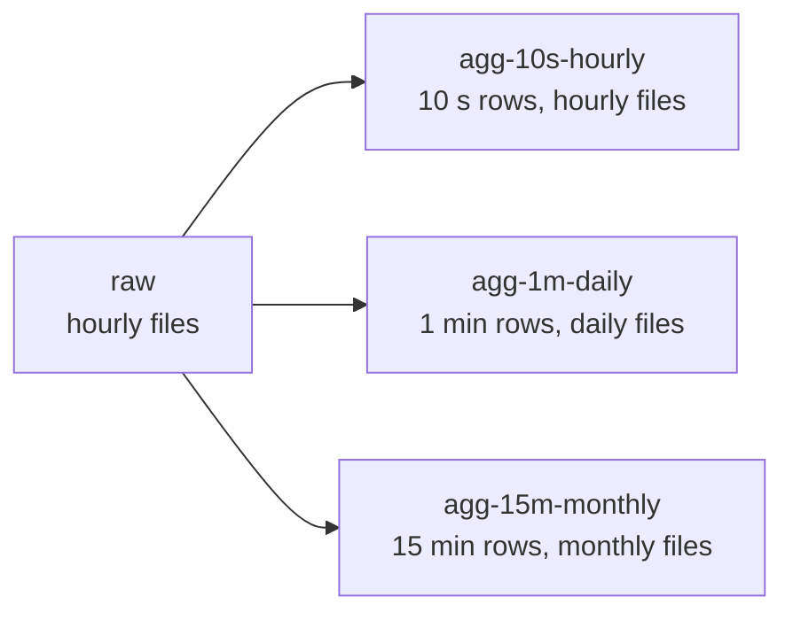

# Aggregation

`Easy.TimeSeries.Aggregation` turns raw readings into coarser views: one row per minute, per hour, per day, and per
group. An aggregated file is an ordinary `.ets` file, readable by the same `Reader`, source-generated readers and the
Parquet converter.

## Two time spans - read this first

Every aggregation is defined by two independent time spans. Mixing them up is the most likely source of mistakes.

| Term | Answers the question | Example | Constraint |
| --- | --- | --- | --- |
| **Aggregation time span** | How much raw time is collapsed into one aggregated row? | 1 minute | Must fit into the storage time span |
| **Storage time span** | How much time does one file cover? | 1 day | Same as the raw storage time span or longer |

An aggregation with a 1-minute aggregation time span and a 1-day storage time span writes one file per day, each
holding up to 1440 rows per group.



## Quick start

```csharp
using Easy.TimeSeries.Aggregation;
using Easy.TimeSeries.Paths;
using Easy.TimeSeries.Storage;

var spec = new AggregationSpec(
        aggregationTimeSpan: AggregationTimeSpan.Minute,
        storageTimeSpan: TimeGranularity.Day)
    .GroupBy("Sensor")
    .Column("Voltage", Agg.Avg, Agg.Min, Agg.Max, Agg.Q95, Agg.Quantile(0.999))
    .Column("Current", Agg.Avg, Agg.StdDev.WithOutput(OutputEncoding.ScaledNumber32(3)))
    .Column("Status", Agg.Last);

var catalog = new FileCatalog(new DirectoryInfo("/data"));
var raw = new PathBuilder("raw", TimeGranularity.Hour);
var downsampler = new Downsampler(spec, rawStorageTimeSpan: TimeGranularity.Hour);

// reads raw/2026/10/25/{00..23}/sensor-a.ets, writes agg-1m-daily/2026/10/25/sensor-a.ets
var result = await downsampler.RunAsync(catalog, raw, "sensor-a", new DateTime(2026, 10, 25, 0, 0, 0, DateTimeKind.Utc));
```

The aggregated file of this spec, for two sensors:

| Timestamp | Sensor | Count | Voltage.Avg | Voltage.Min | ... | Status.Last |
| --- | --- | --- | --- | --- | --- | --- |
| 14:05 | sensor-a | 600 | 230.4 | 228.9 | ... | ok |
| 14:05 | sensor-b | 598 | 229.8 | 227.1 | ... | ok |
| 14:06 | sensor-a | 601 | 231.0 | 229.3 | ... | warn |

## The spec

`AggregationSpec` is immutable: every method returns a new spec, so a base spec can be shared and derived.

| Method | Purpose |
| --- | --- |
| `new AggregationSpec(aggregationTimeSpan, storageTimeSpan)` | Both time spans, required |
| `.Column(label, functions...)` | Predefined functions over one raw column |
| `.Function(function)` | A custom function, usually over several raw columns |
| `.GroupBy(label)` | One series per value of a raw Category column |
| `.Time(label)` | Names the raw time column; needed only when a raw file has several DateTime columns |
| `.CountLabel(label)` | Renames the `Count` column |
| `.WithRoot(root)` | Replaces the default root `agg-{slug}-{word}` |
| `.WithTimeSpans(aggregation, storage)` | Same columns, other time spans |
| `.Describe(rawHeaders)` | The output columns, without decoding data; useful for testing a reader DTO |

Aggregation time spans:

| Value | Slug |
| --- | --- |
| `Second` | `1s` |
| `TenSeconds` | `10s` |
| `Minute` | `1m` |
| `FiveMinutes` | `5m` |
| `FifteenMinutes` | `15m` |
| `Hour` | `1h` |
| `Day` | `1d` |

Rules:

- Slices are aligned to midnight UTC and half-open. A row at 14:05:59.999 belongs to 14:05, one at 14:06:00 to 14:06.
- An aggregated row is stamped with the start of its slice.
- A slice without raw rows produces no row; the time column has a gap. The `Count` column shows sparse slices.
- Output columns are, in order:
  1. time
  2. group, if any
  3. count
  4. one column per function, in the order of `Column` and `Function` calls
- Only raw columns named in the spec are decoded. Raw columns added later are ignored, so the layout depends on the
  spec alone.
- Rows are sorted by time, then group by ordinal string comparison. Recomputing a file never reorders it.

## Predefined functions

| Function | Applies to | Label | Result type |
| --- | --- | --- | --- |
| `Agg.Avg` | numeric | `{column}.Avg` | `double`; `decimal` for Decimal |
| `Agg.Median` | numeric | `{column}.Median` | `double`; `decimal` for Decimal |
| `Agg.Q95`, `Agg.Q99` | numeric | `{column}.Q95`, `{column}.Q99` | `double`; `decimal` for Decimal |
| `Agg.Quantile(p)` | numeric | `{column}.Q{p x 100}`, e.g. `Q99.9` | `double`; `decimal` for Decimal |
| `Agg.Min`, `Agg.Max` | numeric, DateTime, TimeSpan | `{column}.Min`, `{column}.Max` | same as the input |
| `Agg.StdDev` | numeric | `{column}.StdDev` | `double` |
| `Agg.TrueRatio` | Bool | `{column}.TrueRatio` | `double` |
| `Agg.Last` | any | `{column}.Last` | same as the input |

- Numeric means Int32, Int64, Float, Double, ScaledNumber32/64, Decimal and the raw variants.
- A column named without functions defaults to Avg (numeric), TrueRatio (Bool) or Last (Category).
- `.As("label")` sets an explicit label; `.WithOutput(encoding)` an explicit output encoding.
- Every aggregated label must be unique. `Agg.Q95` and `Agg.Quantile(0.95)` on one column collide; `Agg.Median` and
  `Agg.Quantile(0.5)` do not (`Median` and `Q50`).

Definitions:

- **Quantiles** interpolate linearly between the two closest ranks (Hyndman-Fan type 7, as NumPy and Excel
  `PERCENTILE.INC`). Q50 equals the median.
- **StdDev** is the population standard deviation (divides by n); a single row yields 0.
- **Avg** sums integers exactly in `Int128` and doubles with compensated summation. Decimal stays exact.
- **Last** is the row with the latest timestamp; among equal timestamps the row written last in the raw file.

### Non-finite values

- Numeric functions skip NaN. Median and quantiles rank only real values.
- Last copies the value as is, NaN included.
- When every value of a slice is NaN, the result is NaN. `Count` still counts all raw rows.
- Infinity is a value: it sorts to the ends and propagates into Avg and StdDev.

### Result encodings

| Raw column | Min, Max, Last | Avg, Median, quantiles, StdDev |
| --- | --- | --- |
| ScaledNumber32/64 with N decimals | same | same scaled type with N decimals |
| Decimal | Decimal | Decimal; StdDev is Double |
| DateTimeOrdered | DateTimeUnordered, same precision | - |
| Any other | same | Double |

- Min, Max and Last of a DateTimeOrdered column are stored unordered, because with grouping they can decrease.
- When raw files of one aggregated file differ, the finest encoding wins: the most decimal places, or the lossless type
  (Float, Double, Int32, Int64) when the column types differ.
- The aggregated time column is DateTimeOrdered with `Seconds` precision, or `Days` for the `Day` aggregation time span.

### Range of scaled results

The core scaled writers saturate silently. The downsampler therefore checks every result written to a scaled
encoding: NaN, infinity and values whose scaled integer does not fit fail the aggregated file. The error names the
function; set a wider encoding with `.WithOutput(...)`, e.g. StdDev of a 1-decimal voltage stored with 3 decimals so
small spreads do not round to zero.

## Custom functions

A custom function implements `IAggregationFunction<TOut>` and is added with `.Function(...)`. It can read several raw
columns of the same slice, including the time column.

```csharp
public sealed class AveragePower(string voltage, string current) : IAggregationFunction<double>
{
    public string Name => "Power.Avg";

    public IReadOnlyList<AggregationInput> Inputs { get; } =
    [
        AggregationInput.Of<float>(voltage),   // ScaledNumber32 decodes as float
        AggregationInput.Of<double>(current),
    ];

    public OutputEncoding Output => OutputEncoding.ScaledNumber64(decimalPlaces: 1);

    public double Compute(in AggregationSlice slice)
    {
        var u = slice.Values<float>(0);
        var i = slice.Values<double>(1);
        var sum = 0d;
        for (var k = 0; k < u.Length; k++)
        {
            sum += u[k] * i[k];
        }

        return sum / u.Length;
    }
}
```

- `Inputs` order defines the index used with `slice.Values<T>(index)`. Values are aligned row by row, in time order,
  and never empty.
- `T` is the decoded CLR type: `float`, `double`, `decimal`, `int`, `long`, `DateTime`, `TimeSpan`, `bool` or
  `string`.
- A function with several inputs must declare a concrete `Output`. One with a single input may use
  `OutputEncoding.SameAsInput` or `OutputEncoding.FromInputPrecision`.
- `Compute` is called once per slice and must be thread-safe.

`AggregationSlice` members:

| Member | Meaning |
| --- | --- |
| `Values<T>(input)` | One input's values within the slice |
| `Sorted<T>(input)` | Sorted copy without NaN, shared by all functions on the same raw column within the slice |
| `Times` | Timestamps of the rows, non-decreasing |
| `Start`, `End` | Bounds of the slice's aggregation time span |
| `Group` | Group value, or `null` |
| `Project(input)` | A view with only that input, at index 0, for calling a predefined function |

Predefined functions are public classes in `Easy.TimeSeries.Aggregation.Functions` and can be reused inside a custom
one:

```csharp
private readonly Quantile<double> q90 = new("Current", 0.9);

public double Compute(in AggregationSlice slice)
    => slice.Values<float>(0)[^1] * q90.Compute(slice.Project(1));
```

## The downsampler

`Downsampler` computes one aggregated file per call, from all raw files of its storage time span.

| Overload | Input | Output |
| --- | --- | --- |
| `RunAsync(catalog, rawPaths, subjectId, spanStart)` | The subject's raw files found in a catalog | `{spec root}/{date folders}/{subjectId}.ets` in the same catalog |
| `RunAsync(spanStart, rawFiles, target)` | Any `IReadStorage` per raw bucket | Any `IWriteStorage` |
| `RunAsync(spanStart, rawBuffer, target)` | One raw file in memory | Any `IWriteStorage` |

- Every row of a raw file must lie within the raw storage time span its bucket start names. A row outside fails the
  aggregated file with an error naming the raw file.
- When nothing is aggregated, the target is never written to and no file appears.
- Raw files may differ in schema: columns added, reordered, or stored with another type that decodes alike (e.g.
  Double and DoubleRaw). Inputs are matched by label in each file.
- `AggregationResult` reports the rows and groups written and the raw files and rows read.

Raw data is processed in chunks, in time order. A chunk is one raw file, or the raw files of one slice when the
aggregation time span is longer than the raw storage time span (`Day` over hourly files). Peak memory is about one
chunk of the needed columns, however long the storage time span.

## Target paths

The root names both time spans; the date folders below it follow the storage time span.

```text
agg-1m-daily / 2026/10/25 / sensor-a.ets
   │    │         │
   │    │         └─ date folders: storage time span (1 day -> yyyy/MM/dd)
   │    └─ storage time span: daily
   └─ aggregation time span: 1 minute
```

Storage time spans are spelled out (`hourly`, `daily`, `monthly`, `yearly`) so that "month" never collides with the
"m" of minutes. `spec.CreatePathBuilder()` returns the `PathBuilder` of the aggregated files, for range queries.

## Limits and errors

| Situation | Thrown as | When |
| --- | --- | --- |
| Invalid time spans, labels, quantile level, duplicate labels | `ArgumentException` | Building the spec |
| Missing input, wrong CLR type, unsupported function for a type | `AggregationException` | Reading each raw file |
| Row outside its raw file's storage time span | `AggregationException` | Reading each raw file |
| More than 32,767 groups, or group labels over 64 KiB | `AggregationException` | Aggregating |
| More than 255 output columns | `ArgumentException` | Building the spec |
| NaN, infinity or out-of-range value for a scaled encoding | `AggregationException` | Writing results |
| Storage I/O | Original exception | Any |

`AggregationException` carries the raw path, column and function involved, when known.
