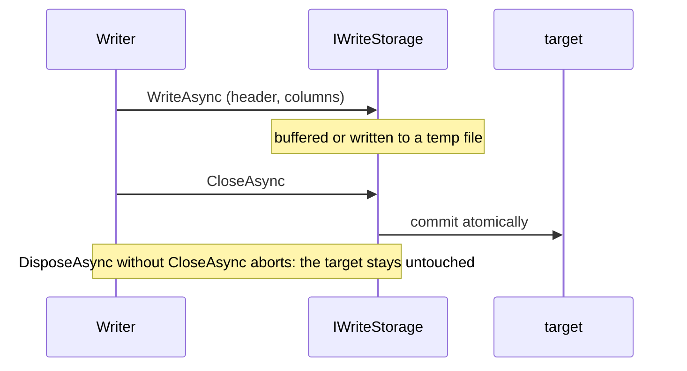

# Storage

Two layers decide where serialized buffers live:

- A **storage** is one buffer: one file, one blob, one in-memory array. `Writer` writes to an `IWriteStorage` and
  `Reader` reads from an `IReadStorage`.
- A **catalog** is a container of buffers addressed by logical path: a local directory or a blob container. It adds
  listing, versions and conditional writes, which a single storage cannot express.

Where a buffer sits inside a container - root, date folders, subject id - is decided by `PathBuilder`, not by the
catalog.

## Breaking changes in 2.0

| Change | What to do |
| --- | --- |
| `AzureBlobStorageFactory` is removed | Use `AzureBlobCatalog` with `PathBuilder.GetFilePath`, see Migration |
| `IWriteStorage` extends `IAsyncDisposable` | Custom storages implement `DisposeAsync`; disposing without close must abort |
| `PathBuilder` joins paths with `/` on every OS | Do not combine its output with `Path.Combine`; map to OS paths only at the file system |
| `PathBuilder.TryParse` matches case-sensitively | Subject ids are lowercase; mixed-case paths no longer parse |

## Writing and aborting



- Disposing after `CloseAsync` only releases resources.
- Disposing without `CloseAsync` aborts the write. Nothing becomes visible and existing content stays as it was.
- Closing a storage that received no data writes nothing.

| Storage | How the commit stays atomic |
| --- | --- |
| `FileStorage` | Writes to `.{name}.{guid}.tmp` in the target directory, then renames it over the target |
| `AzureBlobStorage` | Buffers in pooled memory, then uploads once; the service replaces the blob in one step |
| `InMemoryStorage` | Single buffer, no visibility concerns |

`FileStorage` creates missing directories. A crash can leave an orphaned temp file behind, named
`.{name}.{32 hex digits}.tmp` with the target name cut to 32 characters. Its name never ends in `.ets`, so
`PathBuilder.TryParse` rejects it, and `FileCatalog` neither lists it nor keeps it once recovery removes orphans. Only
that exact shape counts as a temp file; any other name, such as `.settings.tmp`, is an ordinary file.

## Storage catalog

`IStorageCatalog` lives in `Easy.TimeSeries.Abstractions`.

| Member | Purpose |
| --- | --- |
| `ListAsync(prefix)` | Entries whose path starts with the prefix, in no guaranteed order |
| `GetAsync(path)` | One entry with its current version, or `null` |
| `OpenRead(path)` | An `IReadStorage`; a missing path fails on read |
| `OpenWrite(path, ifMatch)` | An `IWriteStorage`; with `ifMatch`, the commit succeeds only if the version is unchanged |
| `DeleteAsync(path, ifMatch)` | `false` when nothing was deleted: missing path or changed version |

Each entry carries:

- the logical path
- the last-modified time
- the size in bytes
- a version

Paths are logical: separated by `/`, relative to the container, without empty, `.` or `..` segments.
`StoragePath.Validate` enforces this in every catalog.

### Versions and conditional operations

A version taken from `GetAsync` or `ListAsync` turns a write or delete into a compare-and-swap:

1. Take the version with `GetAsync`.
2. Do the work, e.g. read the content and compute something from it.
3. Write or delete with `ifMatch` set to that version.

If someone changed the path in between, the conditional write throws `StorageVersionMismatchException` and the
conditional delete returns `false`. Stored content stays untouched in both cases.

| Catalog | Version | Conditional write and delete |
| --- | --- | --- |
| `AzureBlobCatalog` | Blob ETag | ETag precondition checked by the service, atomic |
| `FileCatalog` | Last-write time and size | Compared just before the rename or delete, serialized per file within the process, not atomic across processes |
| `InMemoryCatalog` | Counter | Atomic within the process |

`FileCatalog` therefore supports at most one process doing conditional writes per directory. Within that process,
any number of threads may write and delete concurrently.

### The version of your own write

A version read with `GetAsync` after a write may already belong to somebody else's write of the same path. To know
the version of the bytes you committed, use the storage returned by `OpenWrite`: in all three built-in catalogs it is
an `IVersionedWriteStorage`, whose `CommittedVersion` is set by a successful `CloseAsync`.

```csharp
await using var storage = catalog.OpenWrite(path);
await writer.WriteToAsync(storage, cancellationToken);
var committed = ((IVersionedWriteStorage)storage).CommittedVersion;
```

### Implementations

```csharp
// local directory
var files = new FileCatalog(new DirectoryInfo("/data"));

// blob container
var blobs = new AzureBlobCatalog(connectionString, "timeseries");

// tests and staging
var memory = new InMemoryCatalog(timeProvider);
```

## Paths and subject ids

`PathBuilder` maps a bucket start and a subject id to a path, and back:

```text
raw / 2026/10/25/14 / sensor-a.ets
 │        │              │
 │        │              └─ subject id + suffix
 │        └─ date folders, one level per granularity (here: hour)
 └─ root
```

```csharp
var paths = new PathBuilder("raw", TimeGranularity.Hour);

var bucketStart = paths.GetBucketStart(utcNow);               // 2026-10-25 14:00
var path = paths.GetFilePath(bucketStart, "sensor-a");        // raw/2026/10/25/14/sensor-a.ets
paths.TryParse(path, out var parsedStart, out var subjectId); // true, 14:00, "sensor-a"
```

- Subject ids contain only lowercase letters, digits, `_` and `-`. `GetFilePath` rejects anything else, and
  `PathBuilder.IsValidSubjectId` checks it up front.
- `GetFilePath` is the inverse of `TryParse` for every root, including an empty one.
- `GetBucketStarts(from, to)` yields the starts of all buckets overlapping a range; combine it with `GetFilePath` to
  get the files of one subject.
- `GetExpectedPaths(from, to)` returns the bucket folders and their common prefix, meant as a `ListAsync` filter.
  When the range covers a single bucket, the prefix is that bucket's folder.

Listing the files of a day, for all subjects:

```csharp
var day = new DateTime(2026, 10, 25, 0, 0, 0, DateTimeKind.Utc);
var (_, prefix) = paths.GetExpectedPaths(day, day.AddDays(1));

await foreach (var entry in catalog.ListAsync(prefix))
{
    if (paths.TryParse(entry.Path, out var bucketStart, out var subjectId))
    {
        // ...
    }
}
```

## Migration from AzureBlobStorageFactory

| Before | After |
| --- | --- |
| `new AzureBlobStorageFactory(container, TimeGranularity.Hour)` | `new AzureBlobCatalog(container)` and `new PathBuilder(TimeGranularity.Hour)` |
| `factory.Create(bucketStart)` | `catalog.OpenWrite(paths.GetFilePath(bucketStart, subjectId))` |

The factory wrote `{date folders}/yyyyMMddHH.ets` without a subject id, which `PathBuilder.TryParse` cannot read back.
Files written that way stay readable through `OpenRead` with their existing path.
